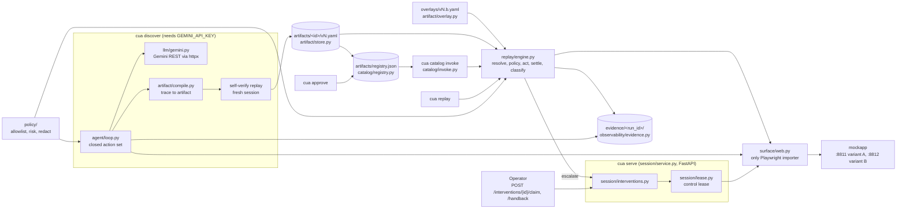

# cua

Record-once, replay-many automation for web applications that have no API: a model explores the
app once, the executed trace is compiled into a reviewable YAML capability, and replay runs that
capability with no model in the loop.

## Demo

No live demo: the system drives a real browser against a local target app. Every run writes its
evidence to `evidence/<run_id>/`, and the recorded runs below are committed in this repository.

A real model-driven discovery run (`run-20261001182355-ba57`) on the bundled mock credit-union back
office reads a balance of `4,218.60`, the value later replays return with no model. All data in the
mock app is synthetic.

<!-- SCREENSHOT: discovery run final screen for member 12345 with the SSN field masked. Save as docs/discovery.png -->

The same capability replayed against tenant variant B without its overlay. `Member ID` is
`Account Holder ID` here, so the run fails closed with `NO_BRANCH_MATCHED` at step `s4` instead of
guessing (`run-20261001202501-6da2`).


<!-- GIF: terminal running `cua replay` for member 12345 and printing {"outputs":{"balance":"4218.60"}}, then member 00000 printing MEMBER_NOT_FOUND. Save as docs/replay.gif -->

### Recorded runs

| What it shows | Run | Outcome |
| --- | --- | --- |
| Model-driven discovery (`gemini-3.5-flash-lite`, 9,257 tokens, 6 steps) | `run-20261001182355-ba57` | saved and self-verified as `mockcu.lookup_member_savings_balance` v1 |
| Deterministic replay, no model | `run-20261001202456-4349` | `Success`, `balance = 4218.60` |
| Business outcome, not a crash | `run-20261001202458-1c6f` | `BusinessOutcome` `MEMBER_NOT_FOUND` for member `00000` |
| Human takes over the live session | `run-20261001202345-e892` | stalled at `s4` on a wrong password, operator claimed, signed in, handed back, run finished `Success` |
| Tenant variant B through an overlay | `run-20261001202459-23c5` | `Success`, steps `s6a` and `s6b` inserted by the overlay |
| Variant B without the overlay | `run-20261001202501-6da2` | `Failure` `NO_BRANCH_MATCHED` at `s4` |
| Discovery reaching an irreversible action | `run-20261001185610-0bdc` | held the Post, escalated, nothing saved |

`evidence/README.md` explains each run and its limits. `evidence/GREP-CHECK.md` lists every discovery
run, failures included, and records a text leak check over `evidence/` and `artifacts/`.

## What it does

- **Discovery** (`cua discover`): an LLM agent drives a real Chromium session through a closed action
  set, seeing the page as an accessibility-tree snapshot. Secret inputs reach the model only as
  `{{password}}`-style placeholders.
- **Compilation from the trace**: the artifact is built mechanically from the executed actions, not
  written by the model, then replayed in a fresh session with separate `--verify-input` values. It
  is saved only if that replay passes.
- **Model-free replay** (`cua replay`): typed inputs and outputs validated against JSON Schema, and a
  three-way result returned as a value: `Success`, `BusinessOutcome` (a code the caller branches on),
  or `Failure` with a kind from a closed taxonomy plus `expected` and `observed`.
- **Declarative error handling**: each step lists `expects` clauses (`continue`, `business`, `retry`,
  `fail`) and a global `recovery` list handles interstitials. A state matching nothing is
  `NO_BRANCH_MATCHED`, which doubles as the drift signal.
- **Tenant overlays**: a variant can rename locators, insert or skip steps, and extend `expects`
  without touching the base artifact's inputs or outputs.
- **Catalog and approval**: `cua catalog list/invoke` and `cua approve`. Drafts are refused, approval
  is a separate human step, and an irreversible capability is turned into an intervention request
  instead of being executed.
- **Human escalation**: `cua serve` runs a session service with a control lease. A human claims an
  intervention, works the same live browser, and hands back with `resolved`, `resolved_manually`,
  `restart_from` or `cannot_resolve`.
- **Safety policy**: per-deployment allowlist with deny rules (enforced on frame navigation and route
  interception), risk classes `safe` / `risky` / `irreversible`, and redaction of protected fields
  and SSN, card and account-number patterns on every evidence write.
- **Mock target app** (`mockapp/`): a frameset credit-union back office with no test IDs, session
  expiry, eight injectable faults, an irreversible Post, and a second tenant variant.

## Architecture



Perception is the accessibility tree rather than screenshots or CSS selectors: it survives restyling,
costs fewer tokens, and is the same abstraction a desktop OS exposes. The cost is that nodes carry no
handles, so mapping an observed node to a replayable role-plus-name locator is a tested module of its
own (`surface/locators.py`). `surface/web.py` is the only module allowed to import Playwright, and
`tests/test_architecture.py` fails the build if anything else does; `Surface` is the seam a desktop
implementation would plug into (not built). The artifact holds what a capability *is* and is
immutable per version; lifecycle state (draft or approved, approver, replay counts) lives in
`registry.json`, so approving never edits a reviewed file. There are two processes only because a
human must take over the *same* live browser, so the session and its lease have to outlive a single
replay call. The tradeoff of compiling from the trace is that a discovered artifact is minimal: it
knows only the states it observed and emits no outputs or business clauses (the replay evidence uses
a v2 hand-authored on top of the discovered v1). Further design notes are in `REPORT.md`, and the 71
numbered decisions are in `docs/context/DECISIONS.md`.

## Stack

- Python 3.12+
- Playwright (Chromium), sync API
- Pydantic v2 for the artifact, result and policy models; JSON Schema exported from them
- FastAPI, Uvicorn, Jinja2 and python-multipart for the session service, operator console and mock app
- Typer for the `cua` CLI
- httpx for the Gemini REST client; PyYAML; python-dotenv
- Dev: pytest, ruff, mypy (strict), jsonschema

## Run it locally

```bash
python3 -m venv .venv
.venv/bin/pip install -e ".[dev]"
.venv/bin/playwright install chromium
cp .env.example .env
```

Only `cua discover` calls a model and needs `GEMINI_API_KEY` (and optionally `CUA_LLM_MODEL`,
default `gemini-3.5-flash-lite`). `cua serve` needs `CUA_OPERATOR_TOKEN` set to any non-empty value.
Everything else runs offline: the target is local, and `artifacts/` already holds a discovered
capability. `cua` below means `.venv/bin/cua`.

Start the two mock app variants in separate terminals:

```bash
.venv/bin/python -m mockapp base   # http://127.0.0.1:8811
.venv/bin/python -m mockapp b      # http://127.0.0.1:8812
```

The mock login is `teller` / `teller-demo-pw` (synthetic, see `.env.example`).
`http://127.0.0.1:8811/search?fault=expired` shows the session-expiry screen.

Replay the committed capability (v2 is already approved in `artifacts/registry.json`):

```bash
# Success: typed outputs
cua replay mockcu.lookup_member_savings_balance 2 --root . --evidence-root . \
  --base-url http://127.0.0.1:8811 --policy policy.demo-a.yaml \
  --input username=teller --input password=teller-demo-pw --input member_id=12345
#   -> {"outputs":{"balance":"4218.60"}, ...}

# Business outcome, exit 0: member 00000 does not exist
cua replay mockcu.lookup_member_savings_balance 2 --root . --evidence-root . \
  --base-url http://127.0.0.1:8811 --policy policy.demo-a.yaml \
  --input username=teller --input password=teller-demo-pw --input member_id=00000
#   -> {"code":"MEMBER_NOT_FOUND", ...}

# Tenant variant B through its overlay (without --overlay: NO_BRANCH_MATCHED at s4)
cua replay mockcu.lookup_member_savings_balance 2 --root . --evidence-root . \
  --base-url http://127.0.0.1:8812 --policy policy.demo-b.yaml \
  --overlay artifacts/mockcu.lookup_member_savings_balance/overlays/v2.b.yaml \
  --input username=teller --input password=teller-demo-pw --input member_id=12345

# Escalation: a wrong password stalls the run, a scripted operator claims and hands back
PYTHONPATH=. .venv/bin/python scripts/handoff_demo.py --policy policy.demo-a.yaml
```

The handoff script drives the real session service through its HTTP routes; only the operator's
hands are scripted. `cua serve` is the interactive form, with a headed browser and the claim and
handback JSON API.

### Catalog

```bash
cua catalog list --root .
cua approve mockcu.lookup_member_savings_balance 2 --root . --approver <your-name>
cua catalog invoke mockcu.lookup_member_savings_balance --root . \
  --base-url http://127.0.0.1:8811 --policy policy.demo-a.yaml \
  --input username=teller --input password=teller-demo-pw --input member_id=12345
```

`catalog invoke` refuses a draft (exit 2). An irreversible capability is never executed: an
intervention request is printed and the exit code is 1. `cua approve` writes to
`artifacts/registry.json`.

### Discovery

Copy `policy.example.yaml` to a scratch file, set its origin to `http://127.0.0.1:8811`, keep
`policy_mode: strict`, then:

```bash
cua discover \
  --goal "Log in using the declared username and password inputs, then look up the member whose id is the declared member_id input and read that member's current savings balance." \
  --root . --base-url http://127.0.0.1:8811 --policy <policy-file> --evidence-root . \
  --id mockcu.lookup_member_savings_balance --name "Look up member savings balance" \
  --input username=teller --secret-input password=teller-demo-pw --input member_id=12345 \
  --verify-input member_id=22222
```

The artifact is saved as `artifacts/<id>/v<N>.yaml` (`--version`, default 1) only if the verify
replay passes. Versions are immutable, and this repository already holds v1 and v2 of that id, so
pass a new `--id` or `--version` to save a fresh run.
Without `--evidence-root`, discovery evidence goes to `~/.cache/cua`. Under `strict` policy a goal
that needs the irreversible Post is escalated: discovery holds the action, never performs it, and
ends `escalated` with nothing saved.

## Tests

```bash
.venv/bin/pytest
.venv/bin/ruff check .
.venv/bin/mypy cua mockapp
```

850 test functions across 55 test files, counted with
`git grep -cE '^\s*(async )?def test_' -- tests`. Nine files use `pytest.mark.parametrize`, so pytest
collects more cases than that. Browser tests need the Chromium install above; none need an API key
(the agent loop is tested against `llm/fake.py`).

## Project layout

```
cua/
  agent/          discovery loop, prompt, and the closed tool set the model may call
  artifact/       artifact models, compiler from trace, validator, overlays, versioned store
  catalog/        registry (draft/approved, replay counts), invoke, tool definitions
  llm/            provider interface, Gemini client, fake for tests, retry
  observability/  evidence writer and structured log
  policy/         allowlist, risk classification, redaction
  replay/         deterministic engine, settle, output extraction, result types
  session/        session service, control lease, interventions, operator console
  surface/        Surface protocol, Playwright web surface, accessibility snapshot, locators
  cli.py          the `cua` command
mockapp/          synthetic credit-union back office, variants A and B, fault injection
artifacts/        saved capabilities, overlay, registry.json
evidence/         recorded runs (traces, results, screenshots, snapshots)
scripts/          handoff_demo.py
tests/            pytest suite, mirroring cua/ and mockapp/
docs/context/     DECISIONS.md, the decision log
REPORT.md         design write-up
```

## Limitations

- `--mode supervised` on `cua replay` is not implemented; the CLI refuses it. Replay with escalation
  runs through the session service (as `scripts/handoff_demo.py` does).
- The idempotency ledger (24 h) and interventions are in memory and per process. The ledger protects
  this side only; it cannot make the target application idempotent.
- The lease is an agent-side mutex and audit record: it stops the automation acting under a person,
  not the person acting.
- Only unassisted successful runs count toward the stability score, which is built but uninformative
  against a deterministic mock.
- Discovery emits no outputs or business clauses; v2 of the evidence artifact was hand-edited from
  the discovered v1.
- No cost figure for discovery: no price is on file for the model. Token counts are exact.
- Failure screenshots can contain PII and were not covered by the text leak check.
- Desktop surface, overlay discovery, persistent idempotency, and console TLS are designed, not built.
